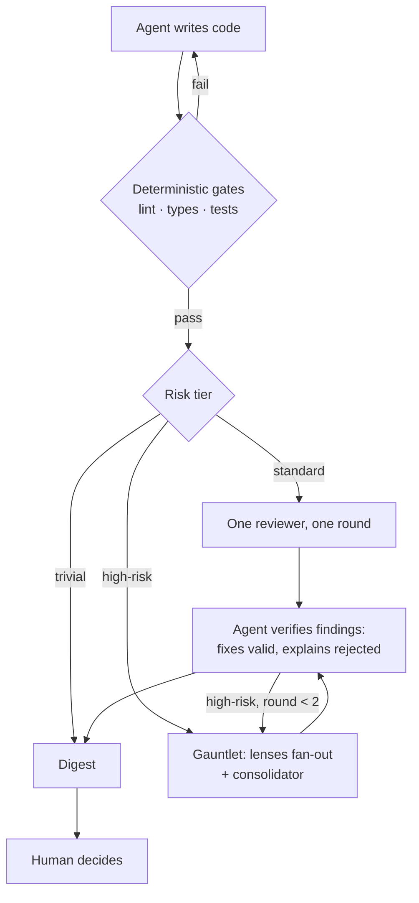

# spiral-review

**Risk-tiered, budget-aware, multi-model code review around your coding agent.**
Machines filter mechanical bugs; the human keeps the decisions.

> **Status: pre-alpha, design phase. Nothing is usable yet.** Everything below describes planned behavior.

## Why

- You code with an AI agent (e.g. Claude Code) on real GitHub PRs, as a solo developer or founder.
- You pay flat-rate subscriptions, not per-token API usage, so quotas belong to your account, not to a repo.
- A single reviewer misses things; many reviewers produce noise.
- Your attention is the scarcest resource, not tokens. Review effort should scale with risk, and only real decisions should reach you.

The name comes from Boehm's spiral model: iterative, risk-driven development. Each review round is a turn of the spiral, and the amount of review scales with the risk of the change.

## How it works



## Operating model

### 1. Deterministic gates first

Lint, type check and tests always run before any LLM review. They are free and more reliable than an LLM reviewer.

### 2. Risk tiers

The tier is computed from the diff: size, sensitive paths (e.g. `migrations/`, `billing/`, `auth/`) and presence of tests.

| Tier                   | LLM review                                                          | Rounds  | Human approval |
| ---------------------- | ------------------------------------------------------------------- | ------- | -------------- |
| trivial                | none                                                                | 0       | no             |
| standard               | one reviewer                                                        | 1       | no             |
| high-risk ("gauntlet") | several lenses, optionally on different models, plus a consolidator | up to 2 | required       |

**Lenses** are reviewers with different focus prompts: logic; edge cases and failure paths; contracts and blast radius; security.
The **consolidator** merges duplicates, verifies findings against the code, drops false positives and emits a final verdict.

### 3. Budgets

- **Per reviewer agent:** max steps and timeout.
- **Per task:** max review rounds.
- **Global, per day/week:** one ledger shared across all repos, because subscription quotas belong to the account.

When a budget is exhausted, review degrades (fewer lenses, cheaper model) instead of silently skipping, and you are told.

### 4. Human digest

One screen per PR:

- what changed and the risk tier
- findings still open
- findings the coding agent rejected, and why
- changes needing a human decision: irreversible or sensitive (migrations, money, auth, public APIs, user data)

### 5. Measurement

spiral-review records which findings the coding agent accepts or rejects, per lens and per model, so noisy reviewers can be pruned. This is how cost/benefit gets tuned over time.

## Architecture (planned)

- **CLI:** TypeScript, distributed via npm (`npx spiral-review`), possibly also as a single binary via `bun build --compile`.
- **Reviewer runners** behind an adapter interface. First adapter: [OpenCode](https://opencode.ai) via its official SDK `@opencode-ai/sdk` (server + client, sessions, per-prompt model selection, event stream, structured output with JSON Schema). Findings come back as typed JSON, not parsed Markdown. Other harnesses can be added later.
- **Core as a library:** an agent-neutral core with a programmatic API; the CLI and coding-agent integrations are thin adapters.
- **Claude Code integration:** a Stop hook. When the agent finishes a turn, spiral-review reviews the uncommitted diff. If the verdict is blocking, findings go back to the agent, which verifies them, fixes the valid ones and explains the rejected ones, in the same session. Loop guards: skip when the diff is unchanged; cap consecutive blocking rounds.
- **OpenCode integration (later):** a plugin with the same loop, for users who code with OpenCode.
- **GitHub integration:** `spiral-review pr` runs locally, reviews the PR diff against its base branch, posts the digest as a PR comment via `gh`, and adds a `needs-human` label for high-risk changes. Keys and quota stay on your machine. A GitHub Action wrapping the same CLI may come later.
- **Configuration layering:** built-in defaults < user config (`~/.config/spiral-review`) < repo config (`.spiral-review.toml`). `REVIEW.md` (path configurable) adds free-text instructions to every reviewer prompt. Built-in lens prompts can be overridden per repo.

### Planned commands

| Command  | Purpose                                       |
| -------- | --------------------------------------------- |
| `init`   | Create config for a repo                      |
| `review` | Review the current diff                       |
| `hook`   | Entry point for the Claude Code Stop hook     |
| `pr`     | Review a GitHub PR and post the digest        |
| `stats`  | Show accept/reject metrics per lens and model |

## Constraints

- **No Claude subscription tokens.** Anthropic restricts subscription (OAuth) credentials to Claude Code and Claude.ai. spiral-review never uses them; it interacts with Claude Code only through its official hook mechanism. Reviewers run on whatever providers you configure in OpenCode.
- **Reviewer quality varies.** Review output is a peer review the coding agent must verify, not orders.
- **Your code goes to your providers.** Reviewers send the diff and any repository files they read to the model providers you configure (e.g. via OpenCode), so their data policies apply. Use local models if code must not leave your machine.

## Status

Pre-alpha. Design and project scaffold done; no releases, nothing usable yet.

## Development

Requires [pnpm](https://pnpm.io); it installs the pinned Node.js version itself.

```sh
pnpm install
pnpm check   # typecheck, lint, format check, tests
pnpm build   # emits dist/
```

Live reviewer test (needs `opencode` 2.x logged in): `SPIRAL_LIVE=1 pnpm test`. It defaults to a free model, which reports `cost` 0; to check cost, set a paid one, e.g. `SPIRAL_LIVE_MODEL=opencode-go/deepseek-v4.1-flash`.

## Roadmap

See [docs/ROADMAP.md](docs/ROADMAP.md): developer-experience north star, planned work, open questions.

## Prior art

- [Open Code Review](https://github.com/spencermarx/open-code-review): multi-agent, multi-model review with a consolidation phase.
- [claude-review-loop](https://github.com/hamelsmu/claude-review-loop): the Claude Code Stop-hook review loop pattern.
- [PR-Agent](https://github.com/The-PR-Agent/pr-agent): mature open-source PR review using API keys.

spiral-review's focus is the operating model (risk tiers, subscription-aware budgets, human digest, reviewer metrics), not the orchestration itself.

## License

[MIT](LICENSE)
