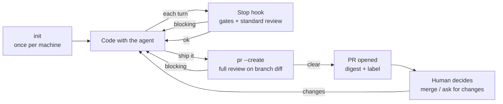

# Roadmap

## North star: developer experience

The target flow. Requirements below are binding for design; numbers and thresholds are decided separately.

1. **Set up once.** `spiral-review init` checks prerequisites (OpenCode, `gh`, auth) and installs the coding-agent integration: the per-turn review, the ship procedure and the `gh pr create` guard (R12). Works with defaults; repo config is optional.
2. **Code.** You only talk to the agent. After each turn the integration runs gates and, if the change is not trivial, a standard review of the uncommitted changes. Blocking findings go to the agent, which fixes or rejects them with reasons. You see one status line, nothing more.
3. **Ship.** You tell the agent to ship (or type `/ship`); the installed ship procedure makes it run `spiral-review pr --create`. That reviews the whole branch against its base at the tier of the branch diff (gauntlet if high-risk).
   - Blocking findings: no PR is opened; the command prints them, saves them to `.spiral-review/`, exits non-zero. The agent fixes and reruns.
   - Clear, or round cap reached: pushes the branch, opens the PR, posts the digest, adds `needs-human` when high-risk, when human decisions are listed, or when findings are unresolved (R10). Unresolved findings are listed in the digest, never hidden.
4. **Decide.** You read one screen on the PR: what changed, tier, open findings, rejected findings with reasons, changes needing your decision. You merge or ask the agent for changes.
5. **Iterate.** New pushes: `spiral-review pr` updates the same digest comment, reusing cached results when the diff is unchanged.

### Requirements

- **R1 - No new habits:** day to day you use only the agent and the PR page; `pr --create` replaces `gh pr create`.
- **R2 - Findings never need a human relay:** they reach the coding agent through the integration or through command output it reads. Exception: only blocking findings are sent; the rest go to the digest (ADR-003 D3).
- **R3 - Quiet when fine:** a passing review is one status line.
- **R4 - Fast inner loop:** the per-turn hook runs only gates and the standard tier; the gauntlet runs only in `pr --create` / `review`.
- **R5 - Agent-runnable commands:** machine-readable output, non-zero exit on blocking findings, results saved under `.spiral-review/` (gitignored).
- **R6 - Bounded:** round caps end every loop; after the cap, the decision moves to the human via the digest.
- **R7 - Never fail closed:** reviewer errors, timeouts and budget degradation are reported in one line and in the digest; work is never blocked by spiral-review failing.
- **R8 - No double spend:** results are cached by diff hash; re-running on an unchanged diff costs no quota.
- **R9 - One digest per PR,** updated in place.
- **R10 - Humans own every merge:** high-risk changes get the full review within budget without asking first. `needs-human` is added when the PR is high-risk, lists changes needing a human decision, or has unresolved findings (R6). It means "read the digest carefully", not "only these need a human". No auto-merge (see [Out of scope](#out-of-scope)).
- **R11 - Same flow on every coding agent** (Claude Code, OpenCode).
- **R12 - Agent behavior is installed, not instructed:** the user never writes prompts or rules to make the agent follow this flow. `init` installs, per coding agent:
  - **Ship procedure:** run `spiral-review pr --create`; on non-zero exit, read the findings, fix each or reject it with `spiral-review dismiss <id> "<reason>"`, rerun; when the PR opens, report link and tier.
  - **Guard:** a pre-tool hook blocks `gh pr create` (and equivalents) and points the agent to `spiral-review pr --create`. Deterministic: works even if the agent ignores the procedure.
  - **Per-turn review:** the Stop hook (Claude Code) or `session.idle` plugin (OpenCode).

  |                 | Claude Code                | OpenCode                                                 |
  | --------------- | -------------------------- | -------------------------------------------------------- |
  | Packaging       | one plugin (skill + hooks) | one plugin (+ command)                                   |
  | Ship procedure  | skill `ship`, also `/ship` | custom command or `AGENTS.md` (skill support unverified) |
  | Guard           | `PreToolUse` hook          | `tool.execute.before`                                    |
  | Per-turn review | `Stop` hook                | `session.idle` event (spike)                             |

  The plugins only call the CLI; logic stays in the core (ADR-001 D7).

## Planned work

In order; each item is a small PR. D-numbers refer to [ADR-001](adr/ADR-001_general-design.md). "Needs" lists open questions to decide first.

- [x] **Scaffold** (D1, D7): strict TypeScript, npm package `spiral-review` exporting a programmatic API, thin CLI with stubs for `init`, `review`, `hook`, `pr`, `stats`; lint, tests and CI for this repo.
- [x] **OpenCode adapter** (D2): reviewer adapter interface; OpenCode 2.x via its HTTP API, read-only on a best-effort basis (only `read` and `glob`, `.env` and symlinks denied), findings as zod-validated JSON ([plan 001](plans/001_opencode-adapter.md)).
- [ ] **MVP** · **Configuration** (D6): defaults < `~/.config/spiral-review` < `.spiral-review.toml` for structured settings (gate commands, nit cap, paths to skip); a per-repo instructions file, free text added to every reviewer prompt, like Anthropic's `REVIEW.md` ([source][anthropic-review]).
- [ ] **MVP** · **Deterministic gates:** run the repo's lint, type check and tests before any LLM review; commands come from config.
- [ ] **MVP** · **Risk tier classifier:** trivial / standard / high-risk from the diff. Deterministic rules set the minimum tier; optional escalators (e.g. a learned classifier) run after them and can only raise it, each with a reason saved with the results. Thresholds: [decision log](decisions.md).
- [ ] **MVP** · **`review`, standard tier:** one reviewer, one round, findings and verdict from the core ([ADR-003](adr/ADR-003_findings-and-review-policy.md)).
- [ ] **MVP** · **Claude Code Stop hook** (D3, D4): thin adapter over the core; `hook` reviews uncommitted diff incl. untracked files; returns `{"decision":"block","reason":...}`; diff-hash guard, round cap, fail-open, verify-don't-obey instructions; sends only blocking findings (ADR-003 D3).
- [ ] **MVP** · **`init`** (north star 1, R12): checks prerequisites (OpenCode, `gh`, auth, `spiral-review` on `PATH`), installs the coding-agent plugin (ship procedure, `gh pr create` guard, per-turn review); hook invocation in the [decision log](decisions.md).
- [ ] **MVP** · **`pr` and `pr --create`** (D5, north star 3–5): branch review, PR creation, digest comment updated in place, `needs-human` label, result cache; digest format in the [decision log](decisions.md).
- [ ] **MVP** · **`dismiss`** (ADR-003 D5): `spiral-review dismiss <id> "<reason>"` records a rejection per branch; dismissed IDs stop blocking and show as rejected in the digest.
- [ ] **Reviewer evals:** a set of diffs with confirmed bugs (from past reverts and fixes); score every prompt, model or lens change against it before keeping it ([source][anthropic-review]). `stats` measures noise; this measures recall.
- [ ] **Gauntlet and consolidator:** lens fan-out, optionally on different models; consolidator merges, verifies, drops false positives.
- [ ] **OpenCode plugin adapter** (D3, D4): spike first — verify a plugin can send findings into the active session on `session.idle`.
- [ ] **Reviewer isolation:** OpenCode permissions are not a sandbox (its threat model), so the read-only reviewer is best effort. Give reviewers no file tools (the diff plus files the core sends), or run OpenCode in a container or OS sandbox. Needed before reviewing untrusted PRs.
- [ ] **Budget ledger and degradation:** per-reviewer, per-task and global budgets; degrade instead of skipping. Needs: budget units, ledger concurrency, degradation order, shared quota.
- [ ] **`stats` and reviewer metrics:** accept/reject rates per lens and model. Needs: accept/reject protocol.
- [ ] **Single binary** (D1, optional): `bun build --compile`.

### MVP milestone

First usable version, used daily on this repo. Items marked **MVP** above, reduced to:

- configuration: built-in defaults, `.spiral-review.toml` and the instructions file; no user-level config;
- risk tiers: rules only, no escalators;
- standard tier only: high-risk changes get the standard review plus `needs-human`. Temporary exception to R10 and north star 3, until the gauntlet lands;
- `init` and integration: Claude Code only. R11 is deferred, not dropped: the core stays agent-neutral (D7).

No budget ledger: the OpenCode adapter's per-reviewer limits (max steps, timeouts) suffice.

Decided: [ADR-003](adr/ADR-003_findings-and-review-policy.md) and the [decision log](decisions.md). The rest waits until MVP use shows it pays off.

## Out of scope

Not planned now; to be re-evaluated later.

- **Auto-merge** (e.g. trivial PRs via GitHub auto-merge). Conflicts with "the human keeps the decisions". Re-evaluate once reviewer metrics show low-risk reviews are reliable and the risk classifier is proven; opt-in only. Prerequisites:
  - tier and verdict as commit statuses on the head SHA: the `needs-human` label is not bound to a commit, and anyone with write access, including the coding agent, can remove it;
  - the merge decision stays outside spiral-review, in a GitHub required status check;
  - findings the coding agent dismissed itself (ADR-003 D5) block auto-merge until a consolidator or the human accepts the rejection.

## Later

Follow-ups with a known trigger.

- **TypeScript 7:** move from 6.0 once typescript-eslint supports it ([#10940](https://github.com/typescript-eslint/typescript-eslint/issues/10940)).
- **GitHub Action** wrapping the CLI (ADR-001 D5). Check OpenCode Go terms first.

## Open questions

Undecided. Each one closes with an ADR or a [decision log](decisions.md) entry.

- **Learned escalator:** e.g. TypeSafe's Jev (calibrated yes/no, label and score answers). Unverified: whether it runs locally (a hosted API sends the diff to another vendor and needs its own key), licensing for an npm CLI, accuracy (measure with reviewer evals first).
- **Security pass:** a separate security review on the standard tier too (Anthropic runs one on every PR, and its findings block), or only the gauntlet's security lens?
- **Accept/reject protocol:** how the coding agent reports per-finding accepted/rejected/fixed by finding ID. Reviewer metrics depend on it. Leaning: four outcomes, fixed / wrong / intentional / doesn't matter ([source][anthropic-review]); "doesn't matter" marks noisy lenses. The MVP's `dismiss` (ADR-003 D5) is the first subset.
- **Budget units:** subscriptions don't expose remaining quota. OpenCode 2.x reports per message, and as session totals, tokens (input, output, reasoning, cache read/write) and `cost` in USD. `cost` is OpenCode's estimate from its price catalog, not the provider's, and is 0 for free models ([plan 001](plans/001_opencode-adapter.md)). Not yet compared with the Zen/Go console.
- **Ledger concurrency:** sessions in different repos may write the global ledger at the same time (file lock, SQLite?).
- **Degradation order** when a budget is exhausted.
- **Shared quota:** with OpenCode for coding and reviewing, how the ledger accounts for coding usage so reviews don't starve it (or vice versa).
- **Claude Code `/code-review`:** overlaps the review step (same-model, Claude quota, user-triggered). Compare against it in reviewer evals: spiral-review earns its keep only if a second model catches bugs it misses.
- **Background and cloud agents:** the hook and `pr --create` run where the coding agent runs. A cloud session (e.g. Claude Code on the web) lacks the user-level plugin, OpenCode and the CLI, so it fails open and opens PRs with plain `gh pr create`: no review, no digest, no `needs-human`. PRs opened while the developer's machine is off wait too. Options: a `watch` mode on an always-on machine that reviews new PRs and pushes; the GitHub Action (Later). Either way a PR without a digest must read as unreviewed, not as clear.
- **Same-model review:** enforce or warn when a reviewer uses the coding agent's model?
- **Loop guards:** combine Claude Code's `stop_hook_active` input with the per-session round cap? Anthropic adds ([source][anthropic-review]): never repeat a finding already raised; after the first rounds, review only what changed since; in the last round before the cap, ask the author to reconsider the approach. At the cap, R6 applies.
- **Outcome guardrail:** track reverts of reviewed changes, so fewer findings can't hide more escaped bugs (Anthropic's guardrail is revert and incident rates, [source][anthropic-review])?
- **OpenCode Go terms:** whether automated use is allowed (relevant before any CI).

[anthropic-review]: https://claude.dev/blog/solving-code-review-at-anthropic/
