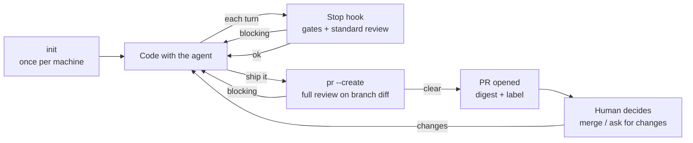

# Roadmap

## North star: developer experience

The target flow. Requirements below are binding for design; numbers and thresholds are decided separately.

1. **Set up once.** `spiral-review init` checks prerequisites (OpenCode, `gh`, auth) and installs the coding-agent integration: the per-turn review, the ship procedure and the `gh pr create` guard (R12). Works with defaults; repo config is optional.
2. **Code.** You only talk to the agent. After each turn the integration runs gates and, if the change is not trivial, a standard review of the uncommitted changes. Blocking findings go to the agent, which fixes or rejects them with reasons. You see one status line, nothing more.
3. **Ship.** You tell the agent to ship (or type `/ship`); the installed ship procedure makes it run `spiral-review pr --create`. That reviews the whole branch against its base at the tier of the branch diff (gauntlet if high-risk).
   - Blocking findings: no PR is opened; the command prints them, saves them to `.spiral-review/`, exits non-zero. The agent fixes and reruns.
   - Clear, or round cap reached: pushes the branch, opens the PR, posts the digest, adds `needs-human` when high-risk, when human decisions are listed, or when findings are unresolved (R10). Unresolved findings are listed in the digest, never hidden.
4. **Decide.** You read one screen on the PR: what changed, tier, open findings, rejected findings with reasons, changes needing your decision. You merge or ask the agent for changes.
5. **Iterate.** New pushes: `spiral-review pr` updates the same digest comment, reusing cached results when the diff is unchanged.

### Requirements

- **R1 - No new habits:** day to day you use only the agent and the PR page; `pr --create` replaces `gh pr create`.
- **R2 - Findings never need a human relay:** they reach the coding agent through the integration or through command output it reads.
- **R3 - Quiet when fine:** a passing review is one status line.
- **R4 - Fast inner loop:** the per-turn hook runs only gates and the standard tier; the gauntlet runs only in `pr --create` / `review`.
- **R5 - Agent-runnable commands:** machine-readable output, non-zero exit on blocking findings, results saved under `.spiral-review/` (gitignored).
- **R6 - Bounded:** round caps end every loop; after the cap, the decision moves to the human via the digest.
- **R7 - Never fail closed:** reviewer errors, timeouts and budget degradation are reported in one line and in the digest; work is never blocked by spiral-review failing.
- **R8 - No double spend:** results are cached by diff hash; re-running on an unchanged diff costs no quota.
- **R9 - One digest per PR,** updated in place.
- **R10 - Humans own every merge:** high-risk changes get the full review within budget without asking first. `needs-human` is added when the PR is high-risk, lists changes needing a human decision, or has unresolved findings (R6). It means "read the digest carefully", not "only these need a human". No auto-merge (see [Out of scope](#out-of-scope)).
- **R11 - Same flow on every coding agent** (Claude Code, OpenCode).
- **R12 - Agent behavior is installed, not instructed:** the user never writes prompts or rules to make the agent follow this flow. `init` installs, per coding agent:
  - **Ship procedure:** run `spiral-review pr --create`; on non-zero exit, read the findings, fix or reject each with a reason, rerun; when the PR opens, report link and tier.
  - **Guard:** a pre-tool hook blocks `gh pr create` (and equivalents) and points the agent to `spiral-review pr --create`. Deterministic: works even if the agent ignores the procedure.
  - **Per-turn review:** the Stop hook (Claude Code) or `session.idle` plugin (OpenCode).

  | | Claude Code | OpenCode |
  |---|---|---|
  | Packaging | one plugin (skill + hooks) | one plugin (+ command) |
  | Ship procedure | skill `ship`, also `/ship` | custom command or `AGENTS.md` (skill support unverified) |
  | Guard | `PreToolUse` hook | `tool.execute.before` |
  | Per-turn review | `Stop` hook | `session.idle` event (spike) |

  The plugins only call the CLI; logic stays in the core (ADR-001 D7).

## Planned work

From [ADR-001](adr/ADR-001_general-design.md), in order; each item is a small PR.

- [x] **Scaffold** (D1, D7): strict TypeScript, npm package `spiral-review` exporting a programmatic API, thin CLI with stubs for `init`, `review`, `hook`, `pr`, `stats`; lint, tests and CI for this repo.
- [ ] **OpenCode adapter** (D2): reviewer adapter interface; OpenCode via `@opencode-ai/sdk`, read-only (edit, bash, webfetch denied), findings as JSON-Schema-validated output. Record what the SDK reports per message (tokens, cost).
- [ ] **Configuration** (D6): defaults < `~/.config/spiral-review` < `.spiral-review.toml`; per-repo lens prompt overrides.
- [ ] **Claude Code Stop hook** (D3, D4): thin adapter over the core; `hook` reviews uncommitted diff incl. untracked files; returns `{"decision":"block","reason":...}`; diff-hash guard, round cap, fail-open, verify-don't-obey instructions. Needs the findings schema and blocking rule.
- [ ] **OpenCode plugin adapter** (D3, D4): spike first — verify a plugin can send findings into the active session on `session.idle`.
- [ ] **`pr` and `pr --create`** (D5, north star 3–5): branch review, PR creation, digest comment updated in place, `needs-human` label, result cache. Needs digest format and risk tiers.
- [ ] **Single binary** (D1, optional): `bun build --compile`.

## Out of scope

Not planned now; to be re-evaluated later.

- **Auto-merge** (e.g. trivial PRs via GitHub auto-merge). Conflicts with "the human keeps the decisions". Re-evaluate once reviewer metrics show low-risk reviews are reliable and the risk classifier is proven; opt-in only.

## Open questions

Undecided. Each one closes with an ADR or a [decision log](decisions.md) entry.

- **Risk tier thresholds:** diff size, sensitive paths, how tests weigh.
- **Findings schema and blocking rule** (severity × confidence).
- **Accept/reject protocol:** how the coding agent reports per-finding accepted/rejected/fixed by finding ID. Reviewer metrics depend on it.
- **Budget units:** subscriptions don't expose remaining quota; check whether the OpenCode SDK reports tokens or cost per message.
- **Ledger concurrency:** sessions in different repos may write the global ledger at the same time (file lock, SQLite?).
- **Degradation order** when a budget is exhausted.
- **Digest format.**
- **Shared quota:** with OpenCode for coding and reviewing, how the ledger accounts for coding usage so reviews don't starve it (or vice versa).
- **Same-model review:** enforce or warn when a reviewer uses the coding agent's model?
- **Loop guards:** combine Claude Code's `stop_hook_active` input with the per-session round cap?
- **OpenCode Go terms:** whether automated use is allowed (relevant before any CI).
