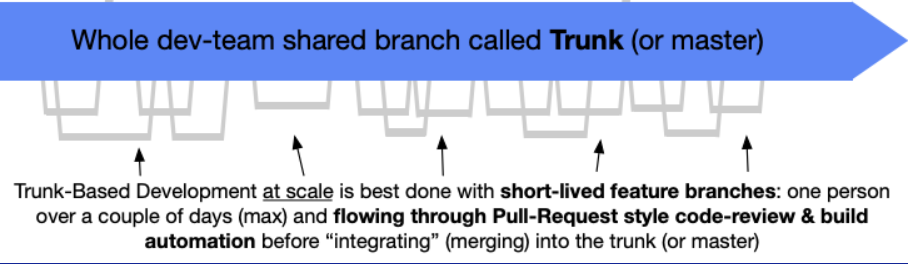

# Source Control

## Table of Contents

1. [General guidelines](#org7a454ab)
2. [Merging strategy](#orgc9f7486)
3. [Branch naming](#org89bbb05)
4. [Commit messages](#orgue08nnxf)

## General guidelines

- We adopt Trunk Based Development. More info: [link](https://trunkbaseddevelopment.com/).
- Our default branch is the 'trunk'.
- Our default branch name is named `main`.
- We merge to the default branch only through PRs. Not enforced on `origin`: branch protection needs GitHub Pro or a public repo.
- We open short-lived branches from the default branch and merge them back to it.
- We don't use release branches (unless strictly necessary) and we release from the default branch.

### Diagram

_Credits: [https://trunkbaseddevelopment.com/](https://trunkbaseddevelopment.com/)_

## Merging strategy

- We squash merge PRs: each PR lands on the trunk as a single commit, keeping history linear.
- The squash commit title is the PR title, so PR titles must follow [Conventional Commits](#orgue08nnxf) (GitHub appends `(#<PR number>)`).
- Commits inside the PR branch are not preserved individually; no need to clean them up before merging.

## Branch naming

- We follow this template `<type>/<work item ID>_<title>`.
  - The `<work item ID>` is the GitHub issue number (without `#`); reference the issue in the PR body (e.g. `Closes #42`) so it is linked and auto-closed.
  - The `<type>` can be one of the following `feature|bug|hotfix|chore|experiment`.
    - `feature`: New feature or enhancement.
    - `bug`: Bug fix.
    - `hotfix`: Critical bug fix that needs to be fixed ASAP and could not follow the traditional process.
    - `chore`: Changes that don't fit in any of the above categories.
    - `experiment`: Experiments.
  - The `<work_item_id>_` can be optional for types `experiment` and `chore`.

### Examples

- `feature/42_add-new-feature` (GitHub issue #42)
- `chore/update-readme`
- `bug/57_fix-bug` (GitHub issue #57)
- `hotfix/63_fix-critical-bug` (GitHub issue #63)
- `experiment/do-not-deploy`

## Commit messages

- The essential parts of a commit message are:
  - subject line: a short description of the commit, maximum 50 characters long.
  - body (optional): a longer description of the commit, wrapped at 72 characters, separated from the subject line by a blank line.
- The subject line should be written in the imperative mood.
- We are using [Conventional Commits](https://www.conventionalcommits.org/en/v1.0.0/). Some examples:
  - `feat: add new feature`
  - `fix: fix user creation critical bug`
  - `chore: update deps`
  - `docs: update readme`
